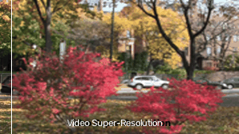
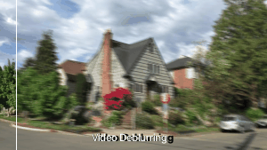
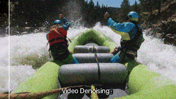
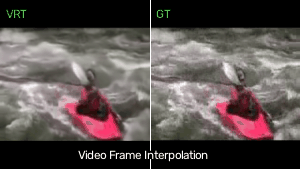
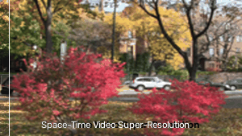

# VRT Demo — Digital Image Processing Course Project

This repository is a course demo for the **Digital Image Processing** course.
It reproduces five video restoration tasks using **VRT: A Video Restoration Transformer**.

- Original repository: <https://github.com/JingyunLiang/VRT>
- Paper: <https://arxiv.org/abs/2201.12288>

## Results

### 1. Video Super-Resolution

Dataset: Vid4 · Model: 003

### 2. Video Deblurring

Dataset: DVD10 · Model: 005

### 3. Video Denoising

Dataset: Set8 (σ = 50) · Model: 008

### 4. Video Frame Interpolation

Dataset: UCF101 · Model: 009

### 5. Space-Time Video Super-Resolution

Dataset: Vid4 · Models: 003 + 009

## Acknowledgement

All model architectures, pretrained weights, datasets, and original code are from the
[VRT repository](https://github.com/JingyunLiang/VRT) by Jingyun Liang et al.
This repository is used only for course demonstration. The original project is released
under the CC-BY-NC license.
